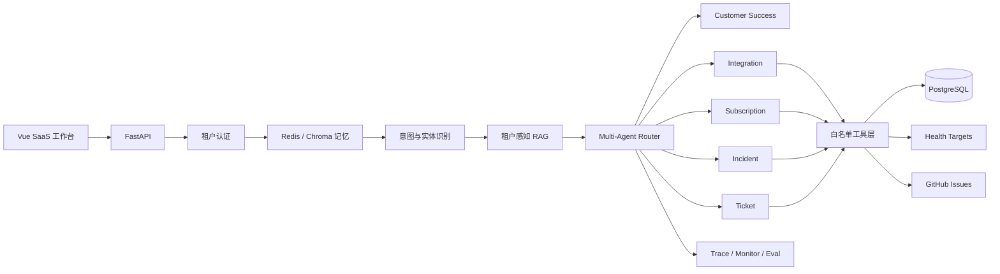

# TenantRelay

面向 B2B SaaS 的多租户 Multi-Agent 智能支持平台。

TenantRelay 不只是聊天机器人。它将租户认证、意图与实体识别、RAG、多个专业 Agent、真实业务工具、工单、监控和评测串成一条可追踪的支持链路。

> English: A multi-tenant AI support orchestration platform for B2B SaaS products.

## 核心能力

- **多租户安全边界**：API Key 哈希存储，Redis Key、RAG 检索和工单均按租户隔离。
- **复合意图识别**：支持主意图与 `secondary_intents`，覆盖 API/SDK、Webhook、权限、套餐、故障和工单。
- **多 Agent 协作**：Customer Success、Integration、Subscription、Incident、Ticket 五类 Agent 按规则协作。
- **真实工具调用**：查询 PostgreSQL 错误目录、租户配置、订阅权限和服务白名单，并持久化工单。
- **租户感知 RAG**：ChromaDB 文档携带租户、产品、版本、可见性和来源元数据。
- **可靠性设计**：工具缓存、超时、熔断、fallback、幂等、审计日志、Trace 和 Prometheus 指标。
- **可替换工单后端**：默认 PostgreSQL，可显式切换 GitHub Issues；未知写入结果不会重复建单。
- **可学习、可评测**：包含课程式学习资料、自动化用例和真实运行指标出口。

## 技术栈

| 层次 | 技术 |
|---|---|
| Web API | Python 3.12、FastAPI、Pydantic、Uvicorn |
| Agent / LLM | 多 Agent 编排、动态 Skills、Anthropic SDK/兼容端点 |
| 数据 | PostgreSQL 16、SQLAlchemy Async、asyncpg、Alembic |
| RAG / 记忆 | ChromaDB、Redis、分层对话记忆 |
| 工具 | httpx、PostgreSQL Tool、GitHub Issues Adapter |
| 可观测性 | Prometheus、自定义 Monitor、Tool Trace |
| 前端 | Vue 3、Vite、Vitest |
| 部署 | Docker、Docker Compose、Nginx |
| 质量 | pytest、pytest-asyncio、Ruff、GitHub Actions |

## 架构概览



详细说明见 [系统架构](docs/architecture.md)。

## 快速开始

### 1. 准备配置

```bash
cp .env.example .env
```

编辑 `.env`，至少设置：

```env
ANTHROPIC_API_KEY=your-real-key
```

也支持 Anthropic 兼容端点：

```env
ANTHROPIC_BASE_URL=https://your-provider.example/anthropic
ANTHROPIC_MODEL=your-model
ANTHROPIC_API_KEY=your-key
```

### 2. 一键启动

```bash
docker compose up -d --build
docker compose ps
```

入口：

- Web：<http://localhost>
- Swagger：<http://localhost/api/docs>
- 后端健康检查：<http://localhost:8000/health>
- Prometheus：<http://localhost:9090>

端口冲突时可以在 `.env` 修改 `APP_PORT`、`BACKEND_PORT` 等值。

### 3. 使用演示租户

本地默认演示配置：

```text
Tenant ID: demo-tenant
API Key:   demo-key-change-me
Product:   AcmeCloud
```

这些值只适用于本地学习，生产环境必须替换。

示例请求：

```bash
curl -X POST http://localhost:8000/chat \
  -H 'Content-Type: application/json' \
  -H 'X-Tenant-ID: demo-tenant' \
  -H 'X-API-Key: demo-key-change-me' \
  -d '{
    "message":"Python SDK 上传接口返回 403，我们刚降级到 basic 套餐",
    "user_id":"user_001",
    "product":"AcmeCloud",
    "environment":"production"
  }'
```

## 关键数据流

```text
租户认证
  → 读取租户命名空间内的记忆
  → 主意图/次级意图与实体抽取
  → RAG 门控与租户过滤
  → 主 Agent + 协作 Agent 路由
  → 真实工具调用
  → 统一回复、来源和 Trace
  → 写回租户记忆与审计日志
```

## 项目结构

```text
backend/                 FastAPI、Agent、RAG、数据层、测试
frontend/                Vue SaaS 工作台
docs/                    架构、API、部署、安全和学习资料
examples/                可执行请求示例
scripts/                 健康检查和演示脚本
.github/workflows/       持续集成
docker-compose.yml       完整本地栈
```

## 测试

```bash
# 前端
npm --prefix frontend ci
npm --prefix frontend test
npm --prefix frontend run build

# 后端（推荐使用 Python 3.12）
python -m pip install -r backend/requirements-dev.txt
cd backend && python -m pytest -q

# Compose 配置
cp .env.example .env
docker compose config --quiet
```

PostgreSQL 集成测试必须使用专用测试库：

```bash
SAAS_TEST_DATABASE_URL=postgresql+asyncpg://... \
  python -m pytest -q backend/tests/test_saas_store_integration.py
```

## 文档入口

- [架构说明](docs/architecture.md)
- [API 使用指南](docs/api-guide.md)
- [配置说明](docs/configuration.md)
- [Docker 部署](docs/deployment.md)
- [安全设计](docs/security.md)
- [演示脚本](docs/demo-guide.md)
- [开发者指南](docs/development.md)
- [小白学习路线](docs/learning/README.md)

## 边界与诚实说明

- 示例产品 `AcmeCloud` 和演示租户均为虚构数据。
- 项目不会执行退款、套餐变更或租户配置写操作。
- 服务状态只访问数据库预配置的白名单地址。
- 仓库不预填 Accuracy、Macro-F1、延迟等简历数字；必须以实际评测结果为准。
- 默认配置用于本地演示，不应直接作为生产安全配置。

## License

[MIT](LICENSE)
