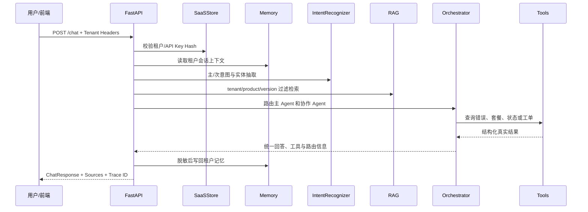

# TenantRelay 系统架构

## 设计目标

TenantRelay 的核心目标不是“回答一句话”，而是在租户隔离的前提下，把理解问题、检索知识、跨角色协作、调用真实工具、生成回复和审计追踪组成完整闭环。

## `/chat` 主链路

## Agent 职责

| Agent | 负责内容 | 典型工具 |
|---|---|---|
| CustomerSuccessAgent | 功能咨询、入门引导、基础配置 | `search_product_docs`、`lookup_tenant_config` |
| IntegrationAgent | API、SDK、Webhook、错误诊断 | `lookup_api_error`、`search_product_docs` |
| SubscriptionAgent | 套餐、权限、配额和到期时间 | `check_subscription` |
| IncidentAgent | 故障影响、服务状态和升级 | `get_service_status` |
| TicketAgent | 交接摘要、建单和状态查询 | `create_support_ticket`、`get_ticket_status` |

## 数据边界

- PostgreSQL 保存租户、订阅、功能开关、错误目录、服务目标、工单和审计日志。
- Redis 使用租户命名空间保存短期对话状态。
- ChromaDB 的文档元数据包含 `tenant_id/product/version/doc_type/visibility/source`。
- GitHub Token 只在工单适配器中读取，不进入 Prompt、Trace 或响应。

## 可靠性机制

- 工具超时、缓存、熔断和 fallback。
- `tenant_id + request_id` 工单幂等。
- GitHub 写入超时且结果不确定时标记 `unknown`，不会切换后端重复建单。
- Monitor 对 Agent 和工具健康度进行统计，路由可基于惩罚分降权。
